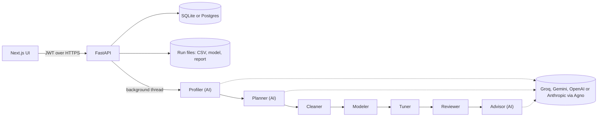

# Auto Data Science Team

Upload a CSV. A team of agents profiles it, cleans it, trains and tunes several models, reviews the result and recommends the one to trust, with the reasoning shown step by step.


## What it does
- **Any CSV in, a decision out.** Detects the target and problem type, then compares a baseline, a linear model, a random forest and gradient boosting.
- **Honest by design.** Leak-safe pipelines (everything is fitted on training data only), duplicates removed before the split, and a recommendation rule that prefers the simpler model when scores are within one standard deviation. It says so when no model beats the baseline.
- **A Reviewer that argues back.** Six code-based checks catch leakage, overfitting, impossible scores, imbalance, tiny test sets and unstable folds.
- **Agents with a safety net.** LLM agents plan and explain, tested code does the ML, and every agent has a rule-based fallback, so a bad or missing AI answer never breaks a run.
- **Take it with you.** Download the trained model, a reproducible `train_model.py` and a short report.
- **Real app basics.** Accounts, per-user run history, daily limits, health check, Docker and CI.

## Architecture


| Agent | Job | Uses an LLM |
|---|---|---|
| Profiler | Summarises the dataset and its risks | Yes, with fallback |
| Planner | Chooses models, target transform and columns to drop. Code validates the plan | Yes, with fallback |
| Cleaner | Removes duplicates and unusable columns | No |
| Modeler | Cross-validates and tests each model | No |
| Tuner | Time-boxed random search on the best model | No |
| Reviewer | Leakage, overfitting and stability checks | No |
| Advisor | Explains the result in plain language using only measured numbers | Yes, with fallback |

## Quick start (local)
Needs Python 3.12 or newer and Node.js 20 or newer.

```bash
# Terminal 1: backend
cd backend
uv sync                         # or: python -m venv .venv, activate it, pip install -r requirements-dev.txt
cp .env.example .env            # optional: add one AI key to switch the agents on
uv run python -m uvicorn app.main:app --reload --port 8000

# Terminal 2: frontend
cd frontend
cp .env.local.example .env.local
npm install
npm run dev
```
Open http://localhost:3000, create an account and upload a CSV. Without an AI key the app still works in rule-based mode.

## Quick start (Docker)
```bash
cp .env.example .env            # set SECRET_KEY (the file shows how to generate one)
cp backend/.env.example backend/.env   # optional: add an AI key
docker compose up --build
```
Frontend on http://localhost:3000, API on http://localhost:8000. Data lives in the `backend-data` volume.

## Configuration
| Variable | Where | Purpose |
|---|---|---|
| `SECRET_KEY` | backend | Signs login tokens. Required when `ENV=production` |
| `ENV` | backend | `production` enforces the secret key |
| `ALLOWED_ORIGINS` | backend | Comma-separated frontend URLs allowed by CORS |
| `DATABASE_URL` | backend | SQLite by default. A Postgres URL also works (`pip install "psycopg[binary]"`) |
| `DATA_DIR` | backend | Where uploads, models and the SQLite file are stored |
| `ALLOW_REGISTRATION` | backend | `false` closes sign-ups |
| `MAX_RUNS_PER_DAY` | backend | Upload limit per user per day (default 30) |
| `GROQ_API_KEY`, `GOOGLE_API_KEY`, `OPENAI_API_KEY`, `ANTHROPIC_API_KEY` | backend | One key switches the AI agents on. `LLM_MODEL` overrides the model |
| `TUNING_BUDGET_SECONDS` | backend | `0` switches tuning off |
| `NEXT_PUBLIC_API_URL` | frontend | Backend address, set at build time |

## API
| Method and path | Purpose |
|---|---|
| `POST /api/auth/register`, `POST /api/auth/login`, `GET /api/auth/me` | Accounts |
| `POST /api/runs` | Upload a CSV and get its profile |
| `POST /api/runs/{id}/train` | Start training in the background |
| `GET /api/runs/{id}` | Progress, timeline steps and results (poll this) |
| `GET /api/runs`, `DELETE /api/runs/{id}` | History and deletion |
| `GET /api/runs/{id}/download/{model,code,report}` | Files |
| `GET /api/health`, `GET /api/config` | Health check and AI status |

Interactive docs at `/docs` when the backend runs.

## Tests and CI
```bash
cd backend && uv run python -m pytest     # 41 tests: ML pipeline, agents, reviewer, accounts, ownership, limits
cd frontend && npx tsc --noEmit && npm run build
```
GitHub Actions runs both on every push and pull request (`.github/workflows/ci.yml`).

## Deploying a demo
A common free setup: frontend on Vercel, backend from `backend/Dockerfile` on Render or Railway, Postgres on Neon. Free tiers change, so check current limits.
1. Create the database and copy its URL into `DATABASE_URL` (add `psycopg[binary]` to `requirements.txt`).
2. Deploy the backend with `ENV=production`, `SECRET_KEY`, `ALLOWED_ORIGINS` (your frontend URL), `DATABASE_URL` and an AI key.
3. Deploy the frontend with `NEXT_PUBLIC_API_URL` set to the backend URL, then add that frontend URL to `ALLOWED_ORIGINS`.
4. Uploaded files and models live on the server disk. On hosts with ephemeral disks they disappear on redeploy, so attach a persistent disk or move artifacts to object storage.
5. Training runs in a background thread. Small free instances may run out of memory on large files, so keep `MAX_BYTES` modest.

## Security notes
- Passwords are hashed with scrypt. Login tokens are signed JWTs valid for 7 days and kept in the browser's local storage, which a cross-site scripting bug could expose. Moving to httpOnly cookies is the next hardening step.
- Every run is tied to its owner. Other users get a 404, not a 403.
- Limits: 20 MB per file, a daily upload cap per user and one training at a time per user.
- There is no email verification or password reset yet.
- The AI provider receives only column names, types, summary statistics and class labels, never raw rows.

## Structure
```
backend/app/main.py        API, auth, limits, background training
backend/app/auth.py        password hashing and tokens
backend/app/db.py          users and runs
backend/app/team.py        the agent team
backend/app/llm.py         Agno model access with fallbacks
backend/app/modeling.py    training, tuning, recommendation
backend/app/review.py      the Reviewer checks
backend/app/artifacts.py   model, script and report files
frontend/                  Next.js (App Router) and Tailwind
```

## Roadmap
Live streaming with SSE, httpOnly cookies, email verification, object storage for artifacts, red-team agent and an AutoML benchmark.
